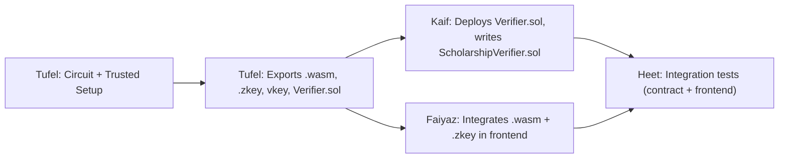

# ProofPass — Shared Interface Contract

> **Every team member must read this before writing code.**
> This document defines the exact data formats, file names, and function signatures that connect all components. **Do not deviate** without team agreement and an update to this file.

---

## 1. Credential Format

The issuer produces a JSON credential. The student uses it as circuit input.

### `shared/sample_credential.json`

```json
{
  "credentialSubject": {
    "name": "Ravi Kumar",
    "studentId": "STU-2026-001",
    "institution": "Demo University",
    "familyIncome": 250000
  },
  "issuer": {
    "id": "did:example:issuer-001",
    "publicKey": "<issuer_public_key_hex>"
  },
  "signature": "<issuer_signature_hex>",
  "issuedAt": "2026-10-24T00:00:00Z"
}
```

> [!IMPORTANT]
> - `familyIncome` is an integer in INR (no decimals, no formatting).
> - The **income threshold** for eligibility is **300000** (₹3,00,000).
> - `signature` is computed over a hash of the credential subject fields.
> - All hex strings are lowercase, no `0x` prefix.

### Field Mapping to Circuit Inputs

| Credential Field | Circuit Signal | Type | Visibility |
|---|---|---|---|
| `familyIncome` | `income` | Private | ❌ Never public |
| `issuer.publicKey` | `issuerPubKey` | Public | ✅ Verifier knows |
| `signature` | `signature` | Private | ❌ Never public |
| Income threshold | `threshold` | Public | ✅ Hardcoded = 300000 |
| Hash of credential | `credentialHash` | Private | ❌ Never public |

---

## 2. Circuit Interface

### Circuit Name: `ScholarshipEligibility`

### File: `circuits/scholarship.circom`

```
template ScholarshipEligibility() {
    // === PRIVATE INPUTS (known only to the student) ===
    signal input income;           // Student's family income (integer)
    signal input signature[2];     // Issuer's signature (r, s components)
    signal input credentialHash;   // Hash of the full credential subject

    // === PUBLIC INPUTS (known to the verifier) ===
    signal input threshold;        // Income ceiling (300000)
    signal input issuerPubKey[2];  // Issuer's public key (x, y components)

    // === OUTPUT ===
    signal output eligible;        // 1 = eligible, 0 = not eligible
}
```

> [!NOTE]
> The exact signal count and signature scheme (EdDSA over BabyJubJub) will be finalised by Tufel. This is the **starting shape** — once Tufel compiles the circuit, the actual `input.json` structure becomes the canonical reference.

### Compilation Outputs (produced by Tufel, consumed by Kaif & Faiyaz)

| File | Location | Used By |
|---|---|---|
| `scholarship.r1cs` | `circuits/build/` | snarkjs (setup) |
| `scholarship.wasm` | `circuits/build/` | snarkjs (proof gen, frontend) |
| `scholarship.sym` | `circuits/build/` | Debugging |
| `verification_key.json` | `shared/` | Verifier contract, frontend |
| `Verifier.sol` | `contracts/` | Kaif (deploy & test) |
| `proving_key.zkey` | `shared/` | Frontend (proof generation) |

---

## 3. Proof Format

snarkjs produces a proof object and public signals array.

### `proof.json` (generated by snarkjs)

```json
{
  "pi_a": ["<bigint>", "<bigint>", "1"],
  "pi_b": [["<bigint>", "<bigint>"], ["<bigint>", "<bigint>"], ["1", "0"]],
  "pi_c": ["<bigint>", "<bigint>", "1"],
  "protocol": "groth16",
  "curve": "bn128"
}
```

### `public.json` (public signals)

```json
[
  "1",                           // eligible (1 = yes, 0 = no)
  "300000",                      // threshold
  "<issuerPubKey_x>",            // issuer public key x-coordinate
  "<issuerPubKey_y>"             // issuer public key y-coordinate
]
```

> [!CAUTION]
> The **order** of public signals in `public.json` is determined by the circuit compilation. Tufel must document the exact order after first successful compilation.

---

## 4. Solidity Verifier Interface

### File: `contracts/Verifier.sol` (auto-generated by snarkjs)

The auto-generated verifier exposes:

```solidity
function verifyProof(
    uint[2] memory a,
    uint[2][2] memory b,
    uint[2] memory c,
    uint[N] memory input    // N = number of public signals
) public view returns (bool)
```

### Wrapper Contract: `contracts/ScholarshipVerifier.sol` (written by Kaif)

```solidity
// SPDX-License-Identifier: MIT
pragma solidity ^0.8.0;

import "./Verifier.sol";

contract ScholarshipVerifier {
    Verifier public verifier;

    event VerificationResult(
        address indexed student,
        bool eligible,
        uint256 timestamp
    );

    constructor(address _verifierAddress) {
        verifier = Verifier(_verifierAddress);
    }

    /// @notice Verify a scholarship proof
    /// @param a      Proof component pi_a
    /// @param b      Proof component pi_b
    /// @param c      Proof component pi_c
    /// @param input  Public signals array
    /// @return result true if proof is valid AND eligible == 1
    function verifyScholarship(
        uint[2] memory a,
        uint[2][2] memory b,
        uint[2] memory c,
        uint[N] memory input
    ) public returns (bool result) {
        // 1. Call the auto-generated verifier
        // 2. Check input[0] == 1 (eligible)
        // 3. Emit VerificationResult event
        // 4. Return result
    }
}
```

> [!NOTE]
> Replace `N` with the actual number of public signals once the circuit is compiled. Kaif must wait for Tufel's compiled output before finalising this contract.

---

## 5. Frontend ↔ Backend Interface

### Proof Generation (in browser via snarkjs)

```javascript
// Required files (served from shared/ or bundled)
const WASM_PATH   = "circuits/build/scholarship.wasm";
const ZKEY_PATH   = "shared/proving_key.zkey";
const VKEY_PATH   = "shared/verification_key.json";

// Generate proof
const { proof, publicSignals } = await snarkjs.groth16.fullProve(
    inputSignals,     // Private + public inputs as JSON object
    WASM_PATH,
    ZKEY_PATH
);

// Verify locally (optional, for UX feedback)
const isValid = await snarkjs.groth16.verify(
    verificationKey,  // Parsed from verification_key.json
    publicSignals,
    proof
);
```

### UI Display Contract

| State | What the UI Shows | Color |
|---|---|---|
| Before proof | "Upload your credential to check eligibility" | Neutral |
| Generating proof | Spinner + "Generating zero-knowledge proof…" | Blue |
| Proof valid + eligible | "✅ ELIGIBLE — Proof verified" | Green |
| Proof valid + not eligible | "❌ REJECTED — Income above threshold" | Red |
| Proof invalid | "⚠️ INVALID — Proof verification failed" | Orange |
| Error | Descriptive error message | Red |

> [!IMPORTANT]
> The UI must **never** display the student's income, credential hash, or signature.

---

## 6. Success & Failure Responses

All components must use these **exact** response shapes for consistency.

### JavaScript (frontend & scripts)

```javascript
// Success
{
  success: true,
  eligible: true,           // or false
  proof: { /* proof.json */ },
  publicSignals: [ /* ... */ ],
  message: "Proof verified successfully"
}

// Failure
{
  success: false,
  eligible: null,
  error: "Invalid proof: verification failed",
  code: "PROOF_INVALID"     // See error codes below
}
```

### Error Codes

| Code | Meaning |
|---|---|
| `PROOF_INVALID` | snarkjs verification returned false |
| `CREDENTIAL_TAMPERED` | Credential hash doesn't match signature |
| `CIRCUIT_ERROR` | Error during witness generation |
| `CONTRACT_REVERT` | Solidity verifier reverted |
| `FILE_MISSING` | Required artifact (wasm, zkey, vkey) not found |
| `INPUT_MALFORMED` | Input JSON doesn't match expected schema |

---

## 7. Dependency Chain & Handoff Order



| Step | Producer | Consumer | Artifact |
|---|---|---|---|
| 1 | Tufel | Everyone | `circuits/build/scholarship.wasm` |
| 2 | Tufel | Kaif | `contracts/Verifier.sol` |
| 3 | Tufel | Faiyaz | `shared/proving_key.zkey`, `shared/verification_key.json` |
| 4 | Tufel | Faiyaz | `shared/sample_credential.json`, `scripts/generate_credential.js` |
| 5 | Kaif | Faiyaz | Deployed contract address (or ABI for local testing) |
| 6 | Kaif | Heet | Contract test results |
| 7 | Faiyaz | Heet | Working frontend for integration testing |

> [!WARNING]
> **Do not start your work with placeholder crypto artifacts.** If Tufel's outputs are not yet available, create a stub file that clearly states `// PLACEHOLDER — waiting for Tufel's circuit compilation output` and skip the crypto logic. Never fake a proof.

---

## 8. Version Agreement

| Item | Value |
|---|---|
| Circom | 2.1.x |
| snarkjs | 0.7.x |
| Solidity | ^0.8.0 |
| Node.js | 18+ LTS |
| Curve | BN128 |
| Protocol | Groth16 |
| Signature scheme | EdDSA over BabyJubJub (circomlib) |

---

*Any changes to this contract must be proposed via a PR or team discussion. Update the "Last updated" timestamp below when changing.*

*Last updated: 2026-10-24*
